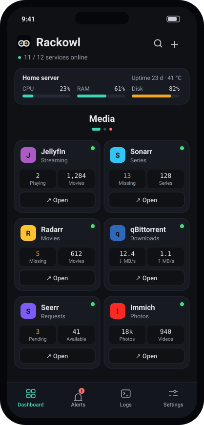
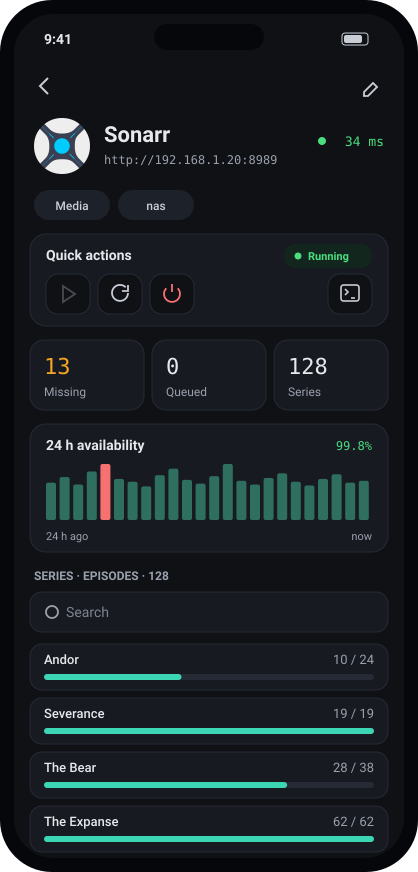
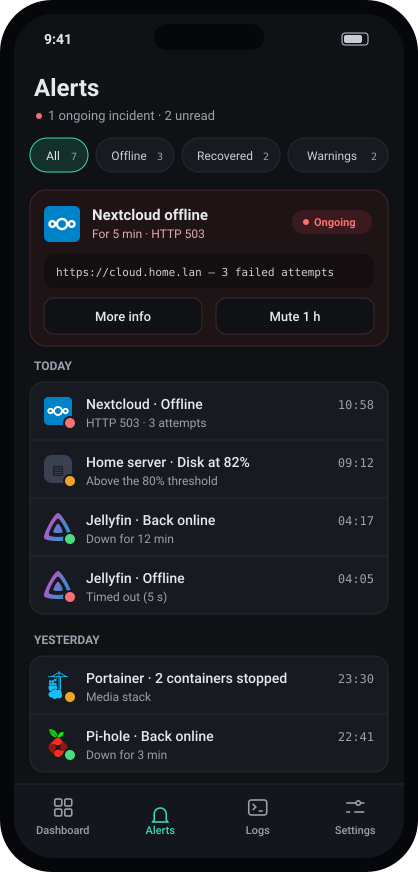
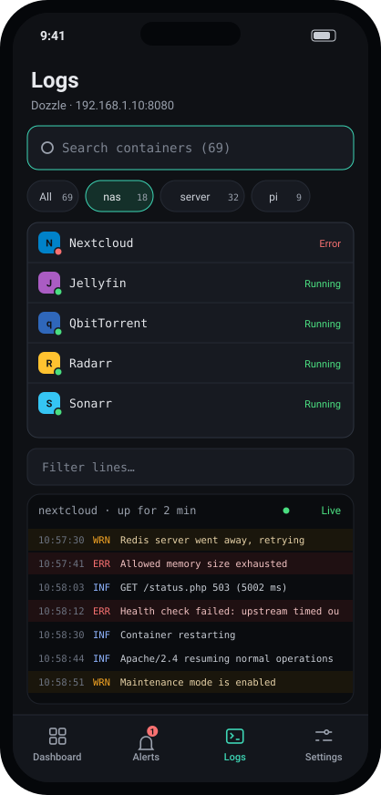

<p align="center">
  
</p>

<h1 align="center">Rackowl</h1>

<p align="center">
  <b>Ton homelab, dans ta poche.</b><br>
  Un tableau de bord Android, version oiseau de nuit, qui veille sur tes services auto-hébergés.
</p>

<p align="center">
  <a href="https://github.com/MrDDream/Rackowl/releases/latest"></a>
  
  
  <a href="https://mrddream.github.io/Rackowl/"></a>
  <a href="LICENSE"></a>
</p>

<p align="center">
  <a href="https://mrddream.github.io/Rackowl/">Site</a> ·
  <a href="https://github.com/MrDDream/Rackowl/releases/latest">Télécharger</a> ·
  <a href="https://apps.obtainium.imranr.dev/redirect?r=obtainium://add/https://github.com/MrDDream/Rackowl">Installer avec Obtainium</a> ·
  <a href="README.md">English version</a>
</p>

<p align="center">
  
  
  
  
</p>

---

## 🦉 Pourquoi Rackowl ?

Tu adores [Homepage](https://gethomepage.dev) sur ton ordi. Sur le téléphone, tu veux plus qu’une page web : une notification quand Jellyfin tombe, un coup d’œil au NAS depuis le canapé, un redémarrage de conteneur sans sortir le portable.

Rackowl, c’est ça. Tout tourne sur ton téléphone : **aucun serveur à héberger, aucun compte, aucun cloud.** Tu lui donnes tes services, il s’occupe du reste.

## ✨ Ce qu’il fait

| | |
| --- | --- |
| 🧩 **156 widgets Homepage** | Sonarr, Jellyfin, Proxmox, OpenMediaVault, Pi-hole, Komodo, TrueNAS, UniFi… dont 126 avec statistiques en direct. Tu choisis ce que chaque tuile affiche. |
| 🐳 **Pilotage des conteneurs** | Ajoute un service directement depuis un conteneur Docker ou Komodo, puis démarre-le, redémarre-le ou arrête-le, avec une confirmation avant. |
| 🔔 **Des alertes utiles** | Via Android, Gotify ou ntfy, seulement après plusieurs échecs si tu veux. Plages de maintenance, heures calmes et services critiques. Dehors sans VPN ? Les services locaux se mettent en pause au lieu de te spammer. |
| 🩺 **Contrôles et diagnostic** | Contrôle HTTP, de port TCP (`tcp://hôte:port`) ou de texte attendu, disponibilité sur 24 h, 7 et 30 jours, et une vue de diagnostic qui montre chaque requête quand un widget reste vide. |
| 📜 **Logs en direct** | Suis n’importe quel conteneur via Dozzle, filtré par serveur, texte ou niveau. |
| 📱 **Widgets d’écran d’accueil** | État des services, ressources serveur (Glances) et un service au choix, avec les vrais logos. Plus des raccourcis et une tuile des réglages rapides. |
| 🔋 **Toujours actif, si tu veux** | Un service de premier plan optionnel, façon Gotify, pour des vérifications à ton rythme même application fermée. |
| 🗂️ **Compatible Homepage** | Import et export de `services.yaml`, synchronisation avec ton instance Homepage, et les labels Docker `homepage.*` sont repris automatiquement. |
| 🔐 **Tes clés restent à toi** | Clés API et mots de passe chiffrés avec l’Android Keystore et jamais inclus dans les sauvegardes. Verrouillage par empreinte en option. |
| 🌍 **Anglais et français** | Thème sombre, clair ou Material You, quatre façons de passer d’une catégorie à l’autre, glisser-déposer et mise en page tablette. |

## 🚀 Démarrer

1. **Télécharge** l’APK de la [dernière version](https://github.com/MrDDream/Rackowl/releases/latest) et ouvre-le sur ton téléphone (Android 8.0+). Pour recevoir les mises à jour automatiquement, ajoute le dépôt dans [Obtainium](https://github.com/ImranR98/Obtainium) ; Rackowl te prévient aussi lui-même quand une nouvelle version sort.
2. **Réglages › Sources** : ajoute tes hôtes Docker, Komodo et Glances, autant que tu veux.
3. **Tableau de bord › +** : ajoute un service à la main ou choisis un conteneur. Rackowl détecte l’intégration ; saisis sa clé API et appuie sur **Tester**.
4. **Réglages › Alertes** : choisis Android, Gotify ou ntfy. C’est tout.

## 🙋 FAQ

<details>
<summary><b>Proxmox affiche 0 VM, sans CPU ni RAM</b></summary>

Ton jeton API a sûrement « Privilege Separation » activé et aucun droit. Dans Proxmox, va dans **Datacenter › Permissions › Add › API Token Permission**, chemin `/`, rôle **PVEAuditor** (lecture seule), avec **Propagate** coché. Utilise `https://IP:8006` comme URL.
</details>

<details>
<summary><b>Je reçois des alertes « injoignable » quand je suis dehors</b></summary>

C’est le rôle de **Réglages › Réseau › Pause hors de chez toi**. Quand ton réseau maison (ou ton VPN) n’est pas joignable, les services locaux sont mis en pause au lieu d’être signalés en panne.
</details>

<details>
<summary><b>Mon service utilise un certificat auto-signé</b></summary>

Active **Réglages › Réseau › Accepter les certificats auto-signés**, uniquement pour les services de ton propre réseau.
</details>

<details>
<summary><b>Un widget n’affiche rien</b></summary>

Ouvre le service et touche l’icône d’insecte. La vue de diagnostic rejoue le contrôle et le widget, et liste chaque requête avec son code et sa réponse ; clés et mots de passe sont masqués. Copie le rapport dans un [ticket « widget »](https://github.com/MrDDream/Rackowl/issues/new/choose) si tu as besoin d’aide.
</details>

<details>
<summary><b>Quels identifiants pour chaque service ?</b></summary>

Les mêmes que dans Homepage : une clé API pour la plupart, un utilisateur et un mot de passe pour certains (OpenMediaVault, qBittorrent…), et une clé plus un secret pour Komodo, Proxmox Backup Server et OPNsense. Le formulaire demande les bons champs dès que tu choisis l’intégration.
</details>

## 🛠️ Compiler

Il faut le JDK 17 et le SDK Android (plateforme 34).

```bash
./gradlew assembleDebug       # app/build/outputs/apk/debug/
./gradlew testDebugUnitTest   # tests unitaires
```

<details>
<summary><b>Version release signée</b></summary>

Crée un fichier `keystore.properties` à la racine du projet (il est ignoré par git) :

```properties
storeFile=/chemin/vers/rackowl-release.jks
storePassword=…
keyAlias=rackowl
keyPassword=…
```

Lance ensuite `./gradlew assembleRelease`, qui crée `app/build/outputs/apk/release/Rackowl-v<version>-release.apk`. En CI, utilise plutôt les variables d’environnement `RACKOWL_STORE_FILE`, `RACKOWL_STORE_PASSWORD`, `RACKOWL_KEY_ALIAS` et `RACKOWL_KEY_PASSWORD`.

Pousser un tag `v*` lance le workflow de publication : il compile l’APK signé et le publie avec le changelog de `fastlane/metadata/android/en-US/changelogs/`.
</details>

Réalisé en Kotlin, avec Jetpack Compose, OkHttp, kotlinx.serialization, Glance et WorkManager.

## 💚 Remerciements

- [Homepage](https://github.com/gethomepage/homepage) : ses widgets servent de référence pour l’API de chaque service.
- [selfh.st icons](https://selfh.st/icons/) pour les icônes, et [Dozzle](https://dozzle.dev) pour les logs des conteneurs.
- [IBM Plex Sans](https://github.com/IBM/plex) et [JetBrains Mono](https://github.com/JetBrains/JetBrainsMono), sous licence SIL Open Font License.

## 📄 Licence

Rackowl est un logiciel libre sous [licence publique générale GNU v3.0](LICENSE).
